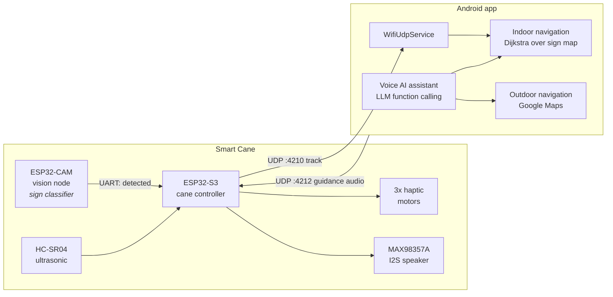
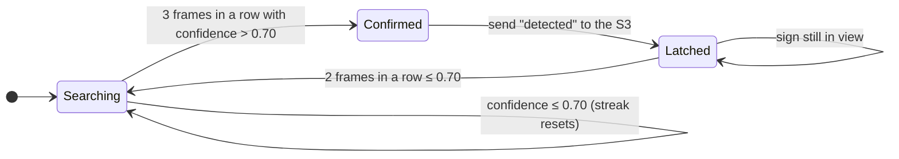
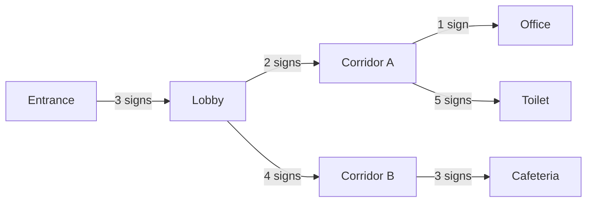
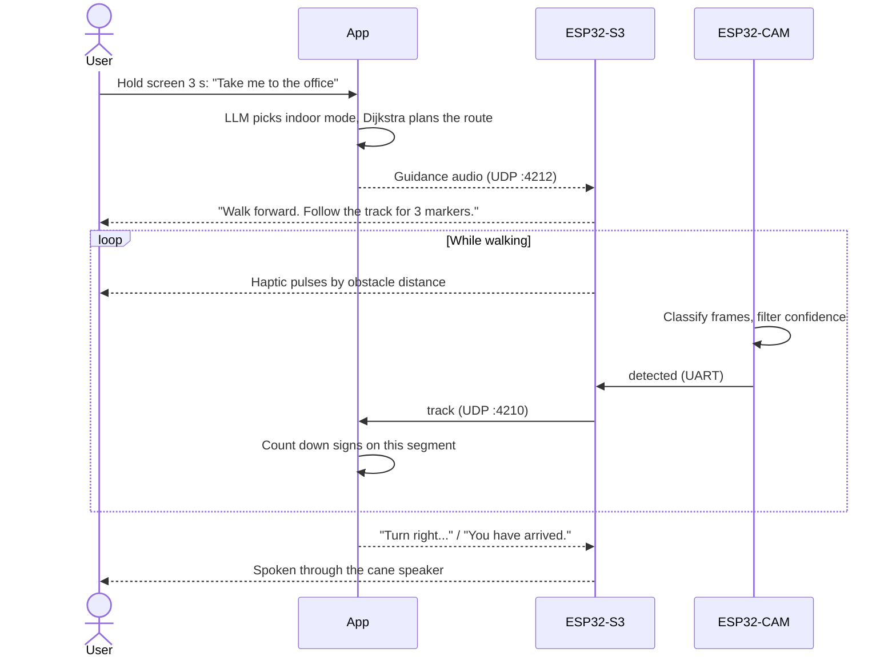

<div align="center">

# SmartWhiteCane

**A smart cane and voice-first companion app that let visually impaired people move independently, indoors and outdoors.**

[](LICENSE)


</div>

---

## Overview

GPS gets a blind user to the right building, then stops working at the door. SmartWhiteCane covers the whole journey:

| | Feature | How it works |
|---|---|---|
| 1 | **Obstacle detection** | An ultrasonic sensor on the cane measures distance. Haptic motors in the handle pulse faster as obstacles get closer, so the user feels the distance without any audio. |
| 2 | **Outdoor navigation** | The app routes the user with the Google Maps API. Spoken guidance is streamed over UDP and played on the cane's speaker. |
| 3 | **Indoor navigation** | Signs fixed along the building's tactile paths are recognised by an on-device ML model on the ESP32-CAM. Routes are planned in signs with Dijkstra's algorithm. |
| 4 | **Voice AI assistant** | Hold anywhere on the screen for 3 seconds, speak, and release. The assistant uses LLM function calling, so it can act as well as answer, for example opening navigation to a spoken destination. |

### Why signs instead of LiDAR or SLAM

Indoor positioning usually needs LiDAR, SLAM or a beacon network, which is expensive to deploy. SmartWhiteCane reuses what many buildings already have: **tactile paving (blind tracks)**. Small signs are fixed along those tracks, and a quantized image classifier on a ~$10 ESP32-CAM recognises each one as the user walks past. Every confirmed sign is one step along a known route, which tells the system where the user is.

---

## System architecture



The cane runs on two microcontrollers:

- **ESP32-CAM (vision node)** runs the sign classifier and reports only *confirmed* signs.
- **ESP32-S3 (cane controller)** runs dual-core firmware: obstacle sensing, haptics and the vision link on core 1, and guidance audio playback on core 0. Obstacle feedback starts at boot and never waits for Wi-Fi.

---

## How it works

### 1. Obstacle detection

The S3 reads the ultrasonic sensor every 60 ms and maps the distance to a zone. Each zone has its own vibration pattern:

| Zone | Distance | Haptic pattern |
|---|---|---|
| Clear | over 150 cm | Off |
| Aware | 80 to 150 cm | Slow pulse (1 s) |
| Warning | 40 to 80 cm | Medium pulse (400 ms) |
| Danger | 15 to 40 cm | Fast pulse (150 ms) |
| Impact | under 15 cm | Continuous, all motors |

### 2. Sign recognition on the ESP32-CAM

The `track_detector` model is an int8-quantized 96x96 image classifier trained in Edge Impulse with two classes, `Track Sign` and `Unknown`. A single frame is never trusted on its own. The vision node confirms a sign with a small filter:



- **Consecutive hits.** A sign is confirmed only after `REQUIRED_CONSECUTIVE` (3) frames *in a row* score above `CONFIDENCE_THRESHOLD` (0.70). One weak frame resets the count, which filters out flicker and false positives.
- **One sign, one event.** After firing, the filter latches until the sign leaves the view. A user who pauses in front of a sign is not counted twice, which matters because routes are counted in signs.
- **Cooldown.** A 3 s minimum gap between signs is a second safety net.

All of these values live in [`firmware/vision_node/config.h`](firmware/vision_node/config.h).

### 3. Indoor navigation

Each building is described as a graph. Nodes are places and edges are walks along the tactile path, weighted by how many signs lie on them:



Dijkstra's algorithm finds the route with the fewest signs, and the app turns it into spoken steps, for example *"Walk forward to the Lobby. Follow the track for 3 markers."* Each `track` event from the cane counts down the current segment. When it reaches zero, the app announces the next turn, and then the arrival.

### 4. A typical journey



---

## Hardware

| Component | Part | Role |
|---|---|---|
| Main controller | ESP32-S3 | Sensing, haptics, audio, Wi-Fi |
| Vision node | ESP32-CAM (AI-Thinker, OV2640) | On-device sign recognition |
| Distance sensor | HC-SR04 ultrasonic | Obstacle ranging |
| Haptics | 3x vibration motors (left, right, bottom) | Distance feedback in the handle |
| Audio | MAX98357A I2S amplifier and speaker | Spoken guidance |
| Power | Rechargeable battery pack | Portable operation |

### Wiring

**ESP32-CAM to ESP32-S3 (UART, 115200 baud)**

| ESP32-CAM | ESP32-S3 |
|---|---|
| U0TXD (GPIO1) | GPIO8 (RX) |
| U0RXD (GPIO3) | GPIO9 (TX) |
| GND | GND |

> The ESP32-CAM uses the same UART for flashing. Disconnect it from the S3 while you upload.

**ESP32-S3 peripherals**

| Signal | GPIO |
|---|---|
| Ultrasonic TRIG / ECHO | 16 / 5 |
| Haptic left / right / bottom | 6 / 7 / 15 |
| I2S BCLK / LRC / DIN | 10 / 11 / 12 |

All pins are defined in [`firmware/cane_controller/config.h`](firmware/cane_controller/config.h).

### Communication protocol

| Link | Transport | Message |
|---|---|---|
| CAM to S3 | UART, newline-terminated | `detected` once per confirmed sign. Other lines are status logs, which the S3 relays to its USB monitor. |
| S3 to app | UDP port 4210 | `track` once per confirmed sign |
| App to S3 | UDP port 4212 | Raw 16-bit mono PCM guidance audio (24 kHz by default) |

---

## Repository layout

```
SmartWhiteCane/
├── firmware/
│   ├── cane_controller/        ESP32-S3: haptics, ultrasonic, audio, Wi-Fi
│   │   ├── cane_controller.ino
│   │   ├── config.h            pins, zones, ports
│   │   └── secrets.example.h   copy to secrets.h for Wi-Fi details
│   └── vision_node/            ESP32-CAM: sign classifier and filter
│       ├── vision_node.ino
│       └── config.h            threshold, frame count, camera board
├── android/                    Android app (Gradle project)
├── Makefile                    arduino-cli and Gradle shortcuts
├── LICENSE
└── NOTICE
```

---

## Getting started

### Prerequisites

- [Arduino IDE 2](https://www.arduino.cc/en/software) or [arduino-cli](https://arduino.github.io/arduino-cli/), with the **esp32 by Espressif** core (tested with 3.3.x)
- The `track_detector_inferencing` library, exported from Edge Impulse as an Arduino library and installed via *Sketch > Include Library > Add .ZIP Library*
- Android Studio for the app

### 1. Flash the vision node (ESP32-CAM)

1. Open `firmware/vision_node/vision_node.ino`.
2. Select **AI Thinker ESP32-CAM** and set *Partition Scheme* to **Huge APP**.
3. Upload. Then reconnect its TX/RX lines to the S3.

### 2. Flash the cane controller (ESP32-S3)

1. Copy `firmware/cane_controller/secrets.example.h` to `secrets.h`. Fill in the Wi-Fi network and the phone's IP address.
2. Open `firmware/cane_controller/cane_controller.ino`, select **ESP32S3 Dev Module**, and upload.
3. Open the serial monitor at 115200 baud. You should see the vision node's status lines, and a `[SIGN] Detected` line whenever a sign is confirmed.

Or from the command line:

```bash
make upload-vision PORT=COM6
```

```bash
make upload-cane PORT=COM5
```

### 3. Build the app

1. Open the `android/` folder in Android Studio.
2. Add your Firebase `google-services.json` to `android/app/`.
3. Put your Google Maps API key in `AndroidManifest.xml`, in place of `YOUR_GOOGLE_MAPS_KEY`.
4. Connect the phone to the same Wi-Fi network as the cane, then run the app.

---

## Tuning

| Setting | File | Default | Effect |
|---|---|---|---|
| `CONFIDENCE_THRESHOLD` | `vision_node/config.h` | `0.70` | Minimum confidence for a frame to count |
| `REQUIRED_CONSECUTIVE` | `vision_node/config.h` | `3` | Frames in a row needed to confirm a sign |
| `REARM_FRAMES` | `vision_node/config.h` | `2` | Frames without the sign before the next one can fire |
| `COOLDOWN_MS` | `vision_node/config.h` | `3000` | Minimum time between two signs |
| `ZONE_*_CM` | `cane_controller/config.h` | 15 / 40 / 80 / 150 | Haptic zone boundaries |
| `AUDIO_SAMPLE_RATE` | `cane_controller/config.h` | `24000` | Must match the audio the app sends |

Raise the threshold or frame count if signs are reported that aren't there. Lower them if real signs are missed while walking.

---

## Project status

| Part | Status |
|---|---|
| Cane firmware (obstacles, haptics, audio, vision link) | Working |
| Sign recognition and filtering on the ESP32-CAM | Working |
| Indoor navigation (sign map and Dijkstra) | Working, demo building map |
| Outdoor navigation (Google Maps) | Working |
| Voice AI assistant | Developed separately; not yet in this repository |

---

## Team

| Name | GitHub |
|---|---|
| Chavindu | [@Navod2022s](https://github.com/Navod2022s) |
| Sanjula | [@Sanjulauni](https://github.com/Sanjulauni) |
| Samodhini | [@Samo1318](https://github.com/Samo1318) |
| Salinda Perera | |

## License

Licensed under the [Apache License 2.0](LICENSE). Third-party attributions are listed in [NOTICE](NOTICE).
